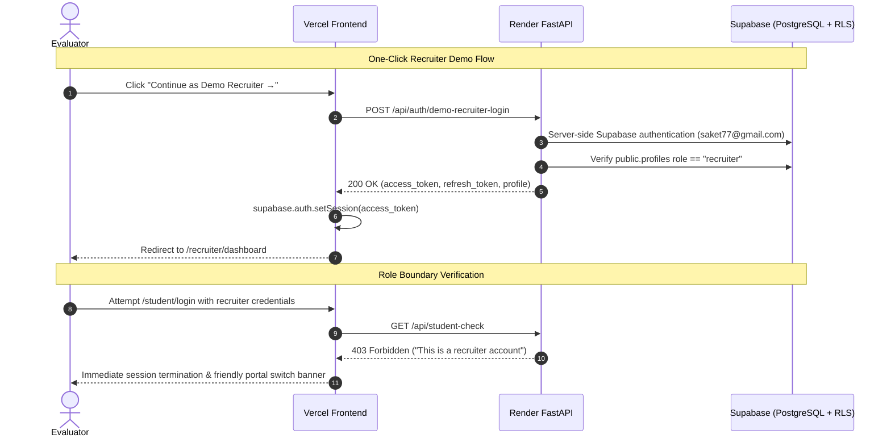
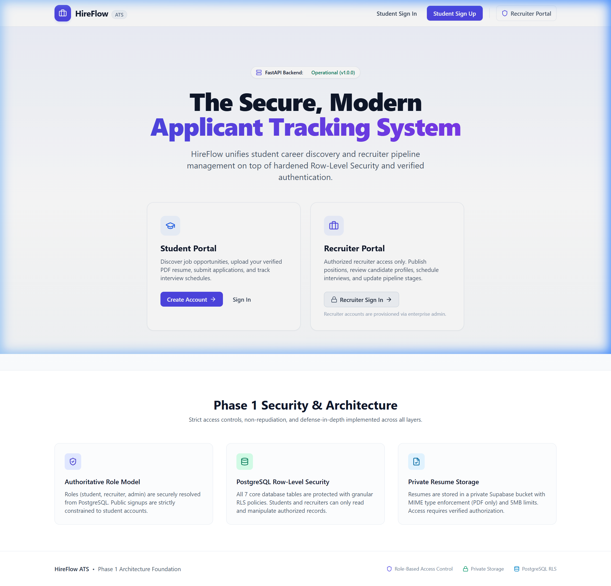
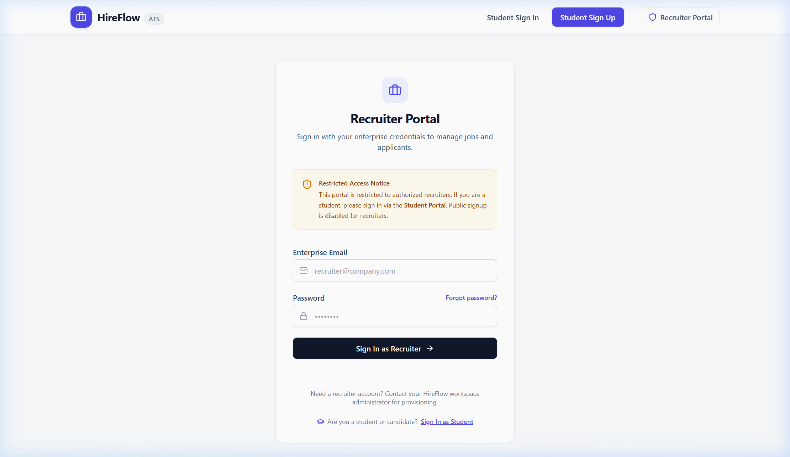
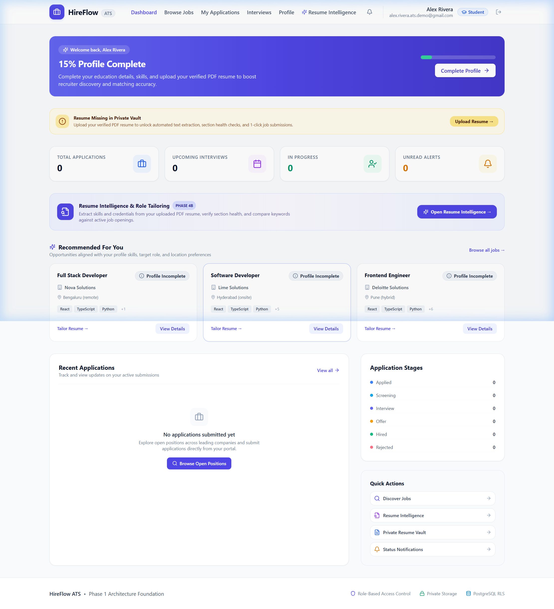
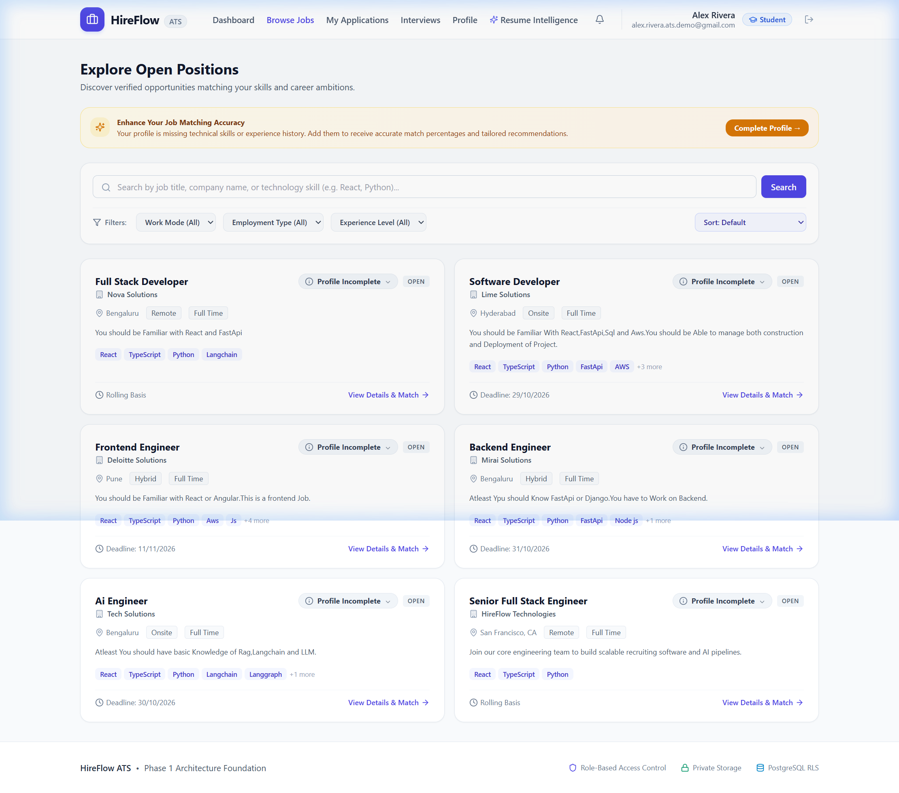
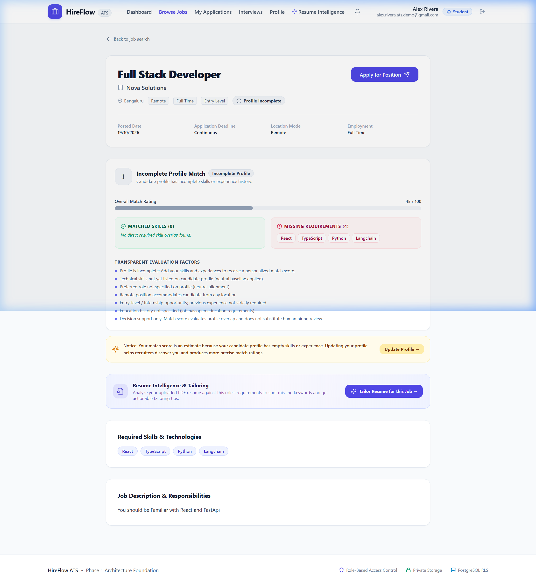
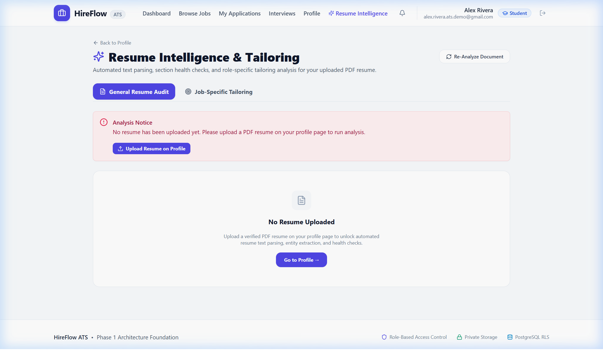
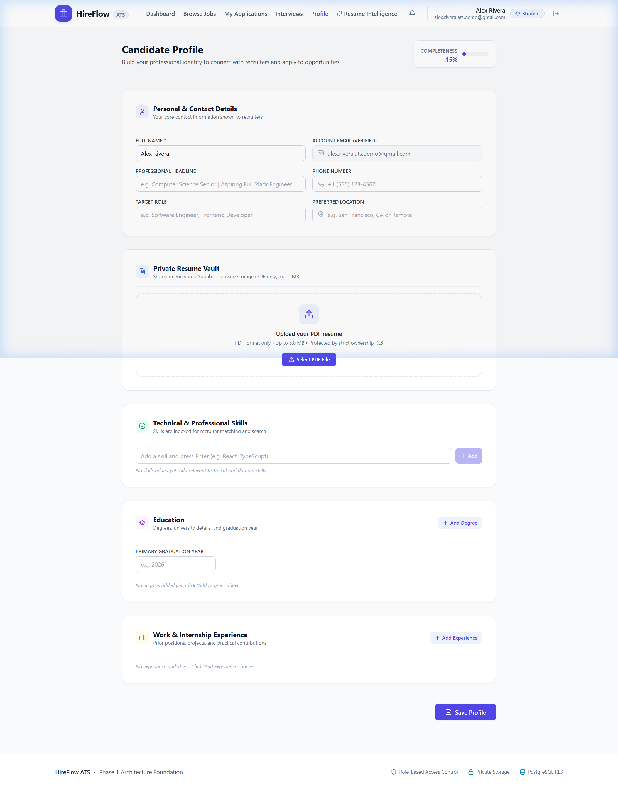
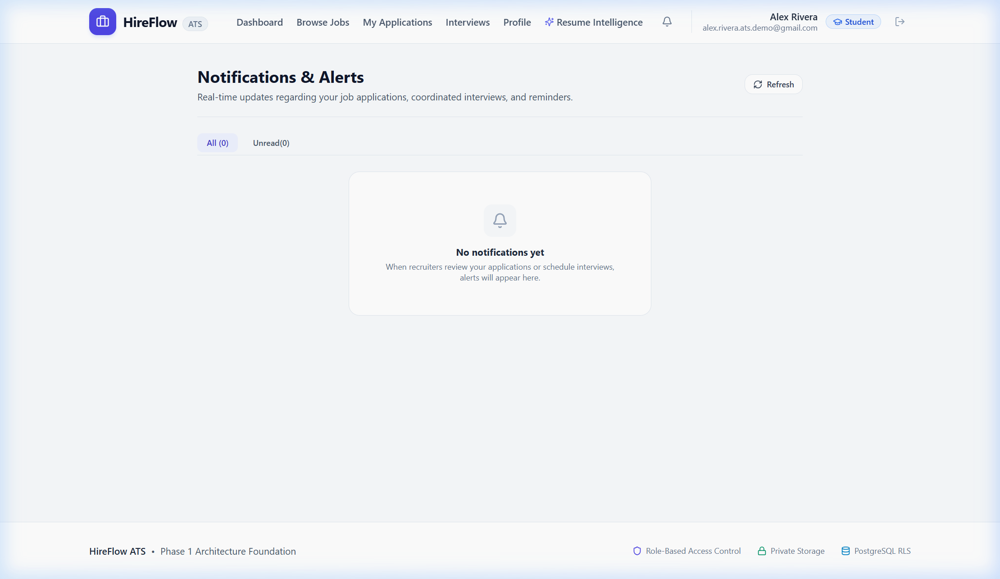
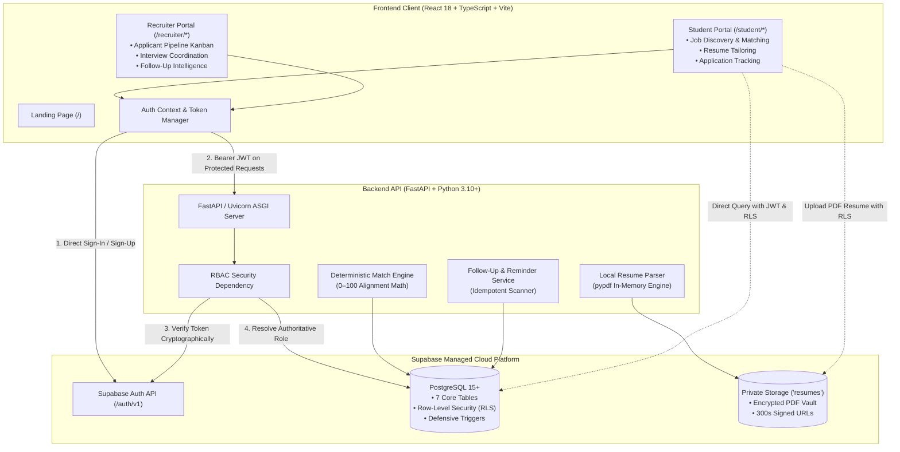

<div align="center">

# 💼 HireFlow
### Modern Applicant Tracking System (ATS) & Talent Acquisition Platform

**A secure, full-stack recruitment platform connecting student talent with corporate hiring teams through deterministic matching, privacy-first resume intelligence, and automated interview workflows.**

<br/>

[](https://hire-flow-beryl-one.vercel.app)
[](https://hireflow-giet.onrender.com/docs)
[](https://hireflow-giet.onrender.com/health)

<br/>

[](backend/tests)
[](frontend/src/pages/auth/__tests__)
[](frontend)
[](backend)
[](frontend)
[](backend)
[](database/migrations)
[](LICENSE)

<br/>

> **Portfolio & Internship Project Notice**: HireFlow was engineered as a comprehensive portfolio and talent-acquisition assignment project. It demonstrates modern full-stack development, defense-in-depth authorization, deterministic algorithm design, and microservices-ready cloud deployment.

[Live Demo](https://hire-flow-beryl-one.vercel.app/) • [Swagger Docs](https://hireflow-giet.onrender.com/docs) • [API Health](https://hireflow-giet.onrender.com/health) • [Recruiter Demo Guide](docs/DEMO_GUIDE.md) • [System Architecture](docs/ARCHITECTURE.md) • [Deployment Guide](docs/DEPLOYMENT.md)

---

</div>

## 📑 Table of Contents

- [Evaluator Demo Account & Testing Guide](#-evaluator-demo-account--testing-guide)
- [Overview](#-overview)
- [Problem & Solution](#-problem--solution)
- [Key Features](#-key-features)
  - [Student Portal](#student-portal)
  - [Recruiter Portal](#recruiter-portal)
  - [Smart Candidate–Job Matching](#smart-candidatejob-matching)
  - [In-House Resume Intelligence](#in-house-resume-intelligence)
  - [Security & Defense-in-Depth](#security--defense-in-depth)
- [Application Screenshots](#-application-screenshots)
- [System Architecture](#-system-architecture)
- [Technology Stack](#-technology-stack)
- [Getting Started](#-getting-started)
  - [Prerequisites](#prerequisites)
  - [1. Database & Supabase Setup](#1-database--supabase-setup)
  - [2. Backend Setup](#2-backend-setup)
  - [3. Frontend Setup](#3-frontend-setup)
- [Environment Variables](#-environment-variables)
- [Testing & Quality Assurance](#-testing--quality-assurance)
- [Production Deployment](#-production-deployment)
- [Known Limitations](#-known-limitations)
- [Future Enhancements](#-future-enhancements)
- [Repository Structure](#-repository-structure)
- [Contributing](#-contributing)
- [License](#-license)

## 🚀 Evaluator Demo Account & Testing Guide

HireFlow is configured and deployed for evaluator testing. Both the **Student** and **Recruiter** portals can be tested independently with zero cross-role contamination.

### 🌐 Live Deployment Endpoints

| Portal / Service | Environment | Provider | URL |
| :--- | :--- | :--- | :--- |
| **Frontend Application** | Production | Vercel | [https://hire-flow-beryl-one.vercel.app](https://hire-flow-beryl-one.vercel.app/) |
| **Recruiter Portal Sign-In** | Production | Vercel | [https://hire-flow-beryl-one.vercel.app/recruiter/login](https://hire-flow-beryl-one.vercel.app/recruiter/login) |
| **Student Portal Sign-In** | Production | Vercel | [https://hire-flow-beryl-one.vercel.app/student/login](https://hire-flow-beryl-one.vercel.app/student/login) |
| **Student Self-Registration** | Production | Vercel | [https://hire-flow-beryl-one.vercel.app/student/signup](https://hire-flow-beryl-one.vercel.app/student/signup) |
| **Backend API Base** | Production | Render | [https://hireflow-giet.onrender.com](https://hireflow-giet.onrender.com/) |
| **API Health Check** | Production | Render | [https://hireflow-giet.onrender.com/health](https://hireflow-giet.onrender.com/health) |
| **Swagger OpenAPI Docs** | Production | Render | [https://hireflow-giet.onrender.com/docs](https://hireflow-giet.onrender.com/docs) |

---

### 🔑 Demo Recruiter Access (One-Click Instant Access)

> [!TIP]
> **No Manual Typing Required**: Evaluators can access the recruiter portal instantly by clicking the prominent **Continue as Demo Recruiter →** button on the [Recruiter Portal Sign-In page](https://hire-flow-beryl-one.vercel.app/recruiter/login).

- **Portal URL**: [https://hire-flow-beryl-one.vercel.app/recruiter/login](https://hire-flow-beryl-one.vercel.app/recruiter/login)
- **One-Click Button**: **Continue as Demo Recruiter →** (authenticates through server-side Supabase credentials and redirects directly to `/recruiter/dashboard`).
- **Configured Recruiter Account**: `saket77@gmail.com`
- **Manual Password (Fallback)**: `Saket7@#`
- **Authoritative Role**: `recruiter`
- **Profile Name**: Saket Recruiter
- **Assigned Recruiter ID**: `d1d8b2c7-c192-4224-a0b5-fb40dd9fde94`

#### Security Architecture of One-Click Demo Login
1. **Server-Side Authentication**: The client does not store or embed passwords or service-role keys. The request is sent to `POST /api/auth/demo-recruiter-login`.
2. **Fixed Account Binding**: The backend exclusively provisions a session for `saket77@gmail.com` (cannot authenticate arbitrary accounts).
3. **Authoritative Role Gating**: Before returning session tokens, the backend queries `public.profiles` to cryptographically verify the user's role is strictly `recruiter`.
4. **Rate Limiting**: Protected by an in-memory sliding window rate limiter (15 requests/minute per client IP) returning HTTP 429 upon abuse.
5. **Supabase Client Session Storage**: The client establishes the session via `supabase.auth.setSession(...)`, activating seamless token refresh and RLS policies.

---

### 🎓 Student Portal Testing (Independent Testing)

- **Student Login**: [https://hire-flow-beryl-one.vercel.app/student/login](https://hire-flow-beryl-one.vercel.app/student/login)
- **Student Signup**: [https://hire-flow-beryl-one.vercel.app/student/signup](https://hire-flow-beryl-one.vercel.app/student/signup)
- **Testing Approach**: Evaluators can register a new student account using any valid email format and password.
- **Student Capabilities to Test**:
  1. Complete candidate profile details (headline, location, graduation year, technical skills) at `/student/profile`.
  2. Upload a PDF resume to the private vault and test in-house resume extraction at `/student/resume-analysis`.
  3. Browse published openings at `/student/jobs`, view deterministic match scorecards, and submit an application.
  4. Track status updates and interview notifications at `/student/applications` and `/student/notifications`.

---

### 🧪 Step-by-Step Evaluator Verification Sequence



1. **Verify One-Click Recruiter Access & Dashboard**:
   - Go to [https://hire-flow-beryl-one.vercel.app/recruiter/login](https://hire-flow-beryl-one.vercel.app/recruiter/login).
   - Under the notice, locate the **Continue as Demo Recruiter →** button.
   - Click the button; observe the loading spinner while server authentication proceeds.
   - Confirm automatic redirection to `/recruiter/dashboard` with aggregate metrics (active jobs, total applicants, stage distribution, and recent applications).
   - Alternatively, test manual entry using `saket77@gmail.com` and `Saket7@#` in the form below.
2. **Verify Job Management**:
   - Navigate to `/recruiter/jobs`.
   - Review pre-seeded opportunities owned by this recruiter account (*Software Developer*, *Frontend Engineer*, *Backend Engineer*, *AI Engineer*, *Full Stack Developer*).
   - Create a new job opening or edit requirements and verify that changes persist.
3. **Verify Candidate Pipeline & Match Ratings**:
   - Navigate to `/recruiter/applicants`.
   - Inspect applicants who applied to your posted opportunities.
   - Click on candidate cards to review candidate profile details, contact information, matched skills, and deterministic 0–100 match factors.
4. **Verify Secure Resume Access**:
   - From any candidate detail modal, click the **View Resume** button.
   - Verify that the resume opens via a secure, time-limited signed Supabase Storage URL (300-second expiration).
5. **Verify Interview Coordination & Stage Transitions**:
   - Advance candidate stages (`applied` &rarr; `screening` &rarr; `interview` &rarr; `offer`).
   - Navigate to `/recruiter/interviews` to schedule a candidate interview round with date, time, format, and meeting coordinates.
6. **Verify Follow-up Intelligence & Reminders**:
   - On the recruiter dashboard, inspect the **Follow-up Intelligence Center**.
   - Review actionable items (e.g. unreviewed candidate applications, upcoming interviews).
   - Trigger the automated reminder scan (`POST /api/recruiter/follow-ups/process-reminders`) directly from the dashboard to idempotently send in-app notifications to scheduled candidates.
7. **Verify Role Isolation & Defense-in-Depth**:
   - **Test Recruiter on Student Login**: Visit `/student/login` and attempt to sign in with `saket77@gmail.com`. The system immediately blocks access, signs out the session, and informs the user: *"This is a recruiter account. Please use Recruiter Login."*
   - **Test Student on Recruiter Route**: When signed in as a student, navigate directly to `/recruiter/dashboard`. The route is blocked by `<ProtectedRoute>` displaying an **Access Restricted** screen with zero leakage of confidential recruiter data.

---

### ⚠️ Evaluator Notes & Cloud Service Considerations

1. **Render Free-Tier Spin-Up (Cold Starts)**:
   The backend API is hosted on Render's free tier. If no requests have been received within 15 minutes, Render spins down the service. The very first request (e.g. initial health check or login) may take **30 to 50 seconds** while the container starts. Subsequent requests respond within 150–250ms.
2. **Shared Evaluation Environment**:
   Data modified during evaluation (new jobs created, applications moved through stages) persists live in Supabase PostgreSQL.
3. **Safe Demo Data**:
   All candidates, jobs, resumes, and contacts in this deployment consist strictly of fictional, synthesized demonstration records.


---

## 💡 Overview

**HireFlow** is an enterprise-inspired Applicant Tracking System designed to streamline campus hiring and early-career talent acquisition. Unlike traditional job boards that overwhelm applicants and bury hiring teams under disorganized resumes, HireFlow delivers:

1. **Role-Separated Workspaces**: Dedicated portals for candidates and recruiters with zero cross-contamination.
2. **Transparent Candidate Matching**: An explainable 0–100 deterministic scoring engine that breaks down skill, role, location, and seniority alignment.
3. **Privacy-Preserving Resume Intelligence**: Zero-dependency, ephemeral PDF text extraction (`pypdf`) with entity detection and job tailoring advice.
4. **Actionable Pipeline Management**: Recruiter Kanban-style stage management, interview scheduling, and a Follow-up Center detecting stale applications.

---

## 🎯 Problem & Solution

| The Recruitment Challenge | How HireFlow Solves It |
| :--- | :--- |
| **Manual, Disjointed Workflows**<br/>Recruiters juggle resumes across email inboxes, spreadsheets, and calendar links. | **Centralized Workspace**<br/>End-to-end management from job publication to applicant evaluation, stage progression, and round feedback. |
| **The "Black Box" Application Void**<br/>Students submit resumes into automated filters without understanding why they were matched or rejected. | **Explainable Match Scoring**<br/>Deterministic 0–100 match ratings with side-by-side lists of matched skills, missing requirements, and positive/negative factors. |
| **Privacy Leaks & Data Exposure**<br/>Resumes stored in public cloud buckets or transmitted insecurely expose sensitive candidate data. | **Hardened Cloud Storage**<br/>Private Supabase Storage with 300-second expiring signed URLs and PostgreSQL Row Level Security (RLS). |
| **Stale Candidates & Missed Interviews**<br/>Hiring teams lose top candidates due to delayed reviews and forgotten interview rounds. | **Follow-up Intelligence Center**<br/>Automated dashboard alerts for applications pending beyond SLA thresholds and scheduled interview rounds. |

---

## ✨ Key Features

### Student Portal
- **Streamlined Authentication**: Email/password registration forced to the `student` role by database triggers.
- **Dynamic Candidate Profile**: Profile completion progress tracker (0–100%), headline, contact details, education, technical skills, and work experience.
- **Private PDF Vault**: Encrypted resume upload stored in private cloud storage, isolated to candidate ownership.
- **Job Discovery & Real-Time Filtering**: Search by job title, company, or technology skill, with filters for work mode (Remote/Hybrid/Onsite), employment type, and experience level.
- **Deterministic Match Badges**: Every job card dynamically displays candidate match percentage and alignment level.
- **Job-Specific Resume Tailoring**: Compares resume text directly against job descriptions to highlight missing keywords and actionable tailoring tips.
- **Application Tracking**: Real-time status tracker across pipeline stages (`applied`, `screening`, `interview`, `offer`, `hired`, `rejected`).
- **In-App Notification Center**: Unread alert counter, filterable tabs, and direct links to updated applications and interview schedules.

### Recruiter Portal
- **Enterprise-Gated Access**: Restricted entry point requiring administrative database provisioning; student tokens receive instant `403 Forbidden` rejection.
- **Job Management**: Create, edit, publish, and close job postings with structured skill requirements, salary brackets, and work-mode specifications.
- **Scoped Applicant Pipeline**: Recruiters can only access candidates who applied to their own job listings.
- **Time-Limited Resume Access**: Resumes are reviewed through 300-second expiring signed URLs, ensuring zero public exposure.
- **Pipeline Stage Progression**: Transition candidates across stages with automated audit logging and candidate notification triggers.
- **Interview Coordination**: Schedule rounds (screening, technical, behavioral, executive), set meeting formats, and record round notes.
- **Follow-up Intelligence Center**: Dedicated dashboard widget identifying:
  - Unreviewed new applications (`applied` stage).
  - Stale applications exceeding stage SLAs (`applied` > 3d, `screening` > 5d, `interview` > 5d, `offer` > 7d).
  - Upcoming interviews in the next 24–48 hours (highlighting <= 24h as High Priority).
  - Completed interviews with missing interviewer feedback.
- **On-Demand Reminder Scan**: Recruiter-triggered idempotent background scanner (`POST /api/recruiter/follow-ups/process-reminders`) that delivers student interview notifications without duplicates.

### Smart Candidate–Job Matching
Built inside [`backend/app/services/matching_service.py`](backend/app/services/matching_service.py):
- **Deterministic 0–100 Score**:
  - **Required Skills Overlap (50 pts max)**: Evaluates candidate skills against job requirements using alias mapping (e.g., `React.js` &rarr; `React`, `TS` &rarr; `TypeScript`, `K8s` &rarr; `Kubernetes`).
  - **Role & Specialization Alignment (20 pts max)**: Matches candidate target role and headline against job titles.
  - **Location & Work Mode (15 pts max)**: Rewards remote flexibility and geographic proximity.
  - **Experience & Education (15 pts max)**: Verifies seniority levels and credentials.
- **Partial-Profile Graceful Handling**: Candidates with incomplete profiles receive an objective baseline with guidance to complete their profile rather than an unjustified 0% score.
- **Ethical Human-in-the-Loop Design**: Explicitly serves as decision support for human hiring managers and never makes automated rejection decisions.

### In-House Resume Intelligence
Built inside [`backend/app/services/resume_intelligence_service.py`](backend/app/services/resume_intelligence_service.py):
- **Pure-Python PDF Extraction**: In-memory text extraction using `pypdf` with zero external paid AI API dependencies.
- **Entity Detection**: Automatically identifies programming languages, frameworks, degrees, graduation dates, and work history.
- **Corrupt & Scanned PDF Guardrail**: Flags multi-page PDFs with < 40 characters of extracted text as scanned images (`is_scanned_or_empty: True`) and prompts candidates to provide searchable text.
- **Profile Discrepancy Highlighting**: Spots differences between extracted resume text and profile form entries without overwriting user data.

### Security & Defense-in-Depth
- **PostgreSQL Row Level Security (RLS)**: Enforced across all 7 database tables. Standard database clients cannot query unauthorized rows.
- **Immutable Roles**: The database trigger `prevent_profile_role_tampering()` prevents users from updating their own role column.
- **Zero-Trust Backend Verification**: The FastAPI dependency cryptographically verifies tokens against Supabase Auth before checking PostgreSQL `public.profiles` for authoritative roles.
- **Recruiter Job Scoping**: Every backend modification confirms `job.recruiter_id == current_user.id`.

---

## 📸 Application Screenshots

### Public Experience & Architecture Verification

| Landing Page & Live Backend Status | Gated Recruiter Sign-In |
| :---: | :---: |
|  |  |
| *Hero section with live backend operational health badge and role-separated entry points.* | *Restricted recruiter portal sign-in featuring zero-trust enterprise notice.* |

---

### Student Experience & Smart Matching

| Candidate Dashboard & Profile Progress | Job Discovery & Match Badges |
| :---: | :---: |
|  |  |
| *Profile completion progress (15%), missing resume alert, stage overview, and recommended jobs.* | *Searchable job catalog with work-mode filters, required skills, and dynamic match tags.* |

| Deterministic Match Scorecard | Resume Intelligence & Tailoring |
| :---: | :---: |
|  |  |
| *Detailed 0–100 match scorecard, matched skills, missing requirements, and human-in-the-loop notice.* | *In-house PDF text parsing, section health checks, and role-specific tailoring tips.* |

| Candidate Profile Builder & Vault | In-App Notification Center |
| :---: | :---: |
|  |  |
| *Personal details, private PDF resume vault, technical skills tags, and education credentials.* | *Real-time application updates, interview alerts, and unread notification tracking.* |

> [!NOTE]
> Recruiter dashboard views (applicant pipeline, candidate detail review, and follow-up center) require an admin-provisioned recruiter account in Supabase. See [database/provision_recruiter.sql](database/provision_recruiter.sql) for provisioning instructions.

---

## 🏗️ System Architecture



For complete technical specifications, review [docs/ARCHITECTURE.md](docs/ARCHITECTURE.md).

---

## 🛠️ Technology Stack

| Layer | Technology | Decision Rationale |
| :--- | :--- | :--- |
| **Frontend Framework** | React 18.3 + Vite 6 | Rapid hot module replacement, predictable state rendering, and optimized production bundle compilation. |
| **Language (Frontend)** | TypeScript 5.8 | End-to-end type safety across API response contracts, application states, and UI components. |
| **Styling** | Tailwind CSS | Utility-first CSS providing a consistent SaaS color scheme (indigo, violet, slate), dark accents, and responsive layouts. |
| **Icons** | Lucide React | Lightweight, consistent iconography for status indicators, pipeline stages, and navigation. |
| **Backend Framework** | FastAPI (Python 3.10+) | High-performance asynchronous execution, automatic OpenAPI schema generation, and native Pydantic validation. |
| **Validation** | Pydantic v2 | Strict type validation for incoming payloads, environment settings, and outbound schema transformation. |
| **PDF Extraction** | `pypdf` 5.0+ | Pure-Python, in-memory text parsing that avoids expensive third-party AI APIs and preserves candidate privacy. |
| **Database** | Supabase PostgreSQL 15+ | Relational data integrity, native Row-Level Security (RLS), and database triggers for automated audit logging. |
| **Authentication** | Supabase Auth | Secure JWT issuance, refresh token rotation, and password hashing. |
| **Storage** | Supabase Storage | Private, encrypted PDF bucket with short-lived signed download URLs (300 seconds). |
| **Testing** | Pytest + Vitest | Comprehensive backend unit/integration tests (69 tests) and frontend component regression tests. |

---

## 🚀 Getting Started

### Prerequisites
- **Node.js**: `>= 18.0.0` (Verified on Node 22)
- **Python**: `>= 3.10.0` (Verified on Python 3.13)
- **Supabase Account**: Free project tier at [supabase.com](https://supabase.com)

---

### 1. Database & Supabase Setup
1. In your Supabase Dashboard, navigate to the **SQL Editor**.
2. Run the migration scripts sequentially from `database/migrations/`:
   ```sql
   -- 1. Tables, foreign keys, and role enforcement triggers
   database/migrations/001_initial_schema.sql

   -- 2. Row Level Security policies across all tables
   database/migrations/002_row_level_security.sql

   -- 3. Private 'resumes' storage bucket and access policies
   database/migrations/003_storage.sql

   -- 4. Audit logging and status change notification triggers
   database/migrations/004_student_portal_enhancements.sql

   -- 5. Recruiter compensation and currency schema updates
   database/migrations/005_recruiter_portal_enhancements.sql
   ```
3. *(Optional)* Populate sample jobs:
   ```sql
   database/seed_jobs.sql
   ```
4. Configure Authentication in **Authentication &rarr; URL Configuration**:
   - **Site URL**: `http://localhost:5173`
   - **Redirect URLs**: `http://localhost:5173/**`

---

### 2. Backend Setup

```bash
# Navigate to the backend directory
cd backend

# Create and activate Python virtual environment
# Windows PowerShell:
python -m venv .venv
.\.venv\Scripts\Activate.ps1

# macOS / Linux:
python3 -m venv .venv
source .venv/bin/activate

# Install dependencies
pip install -r requirements.txt

# Create environment file from template
cp .env.example .env
```

Configure `backend/.env`:
```ini
SUPABASE_URL=https://your-project-id.supabase.co
SUPABASE_PUBLISHABLE_KEY=your-supabase-publishable-key
SUPABASE_SERVICE_ROLE_KEY=your-supabase-service-role-key
CORS_ORIGINS=http://localhost:5173,http://127.0.0.1:5173
HOST=0.0.0.0
PORT=8000
ENVIRONMENT=development
```

Start the FastAPI development server:
```bash
uvicorn app.main:app --reload --port 8000
```
- API Endpoint: `http://localhost:8000`
- Interactive OpenAPI Docs: `http://localhost:8000/docs`
- Health Endpoint: `http://localhost:8000/health`

---

### 3. Frontend Setup

In a new terminal window:

```bash
# Navigate to the frontend directory
cd frontend

# Install dependencies
npm install

# Create environment file from template
cp .env.example .env.local
```

Configure `frontend/.env.local`:
```ini
VITE_API_BASE_URL=http://localhost:8000
VITE_SUPABASE_URL=https://your-project-id.supabase.co
VITE_SUPABASE_PUBLISHABLE_KEY=your-supabase-publishable-key
```

Start the Vite development server:
```bash
npm run dev
```
Open your browser at `http://localhost:5173`.

---

## 🔐 Environment Variables

### Frontend (`frontend/.env.local`)
Variables with `VITE_` are bundled into the client application. **Never place secrets here.**

| Variable | Required | Exposure | Description |
| :--- | :---: | :--- | :--- |
| `VITE_API_BASE_URL` | Yes | Public Client | Base URL for FastAPI backend (e.g., `http://localhost:8000`) |
| `VITE_SUPABASE_URL` | Yes | Public Client | Your Supabase project URL (`https://<id>.supabase.co`) |
| `VITE_SUPABASE_PUBLISHABLE_KEY` | Yes | Public Client | Supabase publishable/anon key for browser client |

### Backend (`backend/.env`)
Backend variables are strictly server-side and must never be exposed.

| Variable | Required | Exposure | Description |
| :--- | :---: | :--- | :--- |
| `SUPABASE_URL` | Yes | Server Only | Supabase project API base URL |
| `SUPABASE_PUBLISHABLE_KEY` | Yes | Server Only | Anon key used for Supabase Auth token validation |
| `SUPABASE_SERVICE_ROLE_KEY` | Yes | **Secret** | Supabase service-role secret key (administrative queries only) |
| `CORS_ORIGINS` | Yes | Server Only | Comma-separated list of allowed frontend origins |
| `HOST` | No | Server Only | Host binding address (default: `0.0.0.0`) |
| `PORT` | No | Server Only | Server listening port (default: `8000`) |
| `ENVIRONMENT` | No | Server Only | Runtime environment (`development`, `test`, `production`) |

---

## 🧪 Testing & Quality Assurance

HireFlow maintains high test coverage across critical security boundaries, matching logic, and application flows.

### Backend Automated Test Suite (Pytest)
```bash
# Run all backend tests from the project root
.\.venv\Scripts\python.exe -m pytest backend/tests -v
```
**Verification Result**:
- **69 tests passed** in 3.68s (100% pass rate).
- Test areas:
  - `test_auth.py`: Token verification, role resolution, recruiter gate checks.
  - `test_matching.py`: Scoring arithmetic, skill aliases, location weighting, incomplete profile baselines.
  - `test_resume_intelligence.py`: PDF text extraction, entity detection, corrupt & scanned document guardrails.
  - `test_follow_up_and_notifications.py`: SLA threshold triggers, interview scanner, idempotency verification.
  - `test_jobs_and_applications.py`: Job listings, single-application enforcement, stage transitions.
  - `test_recruiter.py`: Ownership isolation, candidate review, signed resume URL generation.
  - `test_student_profile.py`: Profile completion math, field validation.
  - `test_health.py`: Operational status checks.

### Frontend Component Tests (Vitest)
```bash
# Run frontend test suite
npm --prefix frontend test
```
**Verification Result**:
- **6 tests passed** (auth redirects, protected routes, and signup regressions).

### Frontend Production Build
```bash
# Verify TypeScript compilation and Vite bundling
npm --prefix frontend run build
```
**Verification Result**:
- `tsc && vite build` completed cleanly with **zero TypeScript errors**.

### Live API Health Check
```bash
curl https://hireflow-giet.onrender.com/health
# Response: {"status":"ok","service":"hireflow-backend","version":"1.0.0","database_configured":true}
```

---

## 🌐 Production Deployment

| Service | Host | Root Directory | Build / Start Command |
| :--- | :--- | :--- | :--- |
| **Frontend** | [Vercel](https://vercel.com) | `frontend` | Build: `npm run build` &bull; Output: `dist` |
| **Backend** | [Render](https://render.com) | `backend` | Build: `pip install -r requirements.txt`<br/>Start: `uvicorn app.main:app --host 0.0.0.0 --port $PORT` |
| **Database & Auth** | [Supabase](https://supabase.com) | `database` | SQL Migrations `001` through `005` |

For production setup details and SPA routing rules, see [docs/DEPLOYMENT.md](docs/DEPLOYMENT.md).

---

## ⚠️ Known Limitations

In the spirit of engineering transparency, the current implementation has the following known boundaries:
1. **Manual / Triggered Reminder Scan**: The interview reminder scanner runs on-demand via the recruiter dashboard or via manual CLI/cron invocation (`python -m app.services.follow_up_service`). A persistent 24/7 background worker is not configured on the free hosting tier.
2. **In-App Notifications Only**: Real-time notifications are delivered through the in-app notification center; external email (SendGrid/Resend) and SMS (Twilio) channels are not yet connected.
3. **Calendar Integrations**: Meeting links and calendar invites are recorded manually by recruiters; direct two-way Google Calendar or Outlook synchronization is not yet integrated.
4. **Text-Only PDF Parsing**: The resume parser uses pure-Python `pypdf`. Image-only or non-OCR scanned PDFs yield no extractable text and trigger the scanned document advisory.
5. **Live End-to-End Scope**: Automated tests thoroughly validate business logic and security policies; full end-to-end browser tests against live production databases remain an ongoing QA milestone.

---

## 🔮 Future Enhancements

- [ ] **Automated Cron Trigger**: Lightweight GitHub Actions scheduled workflow to trigger the interview reminder endpoint hourly at zero cost.
- [ ] **Transactional Email Notifications**: Integration with Resend or SendGrid for application stage change and interview alert emails.
- [ ] **Calendar Synchronization**: One-click Google Calendar / Microsoft Outlook invite creation with automated Google Meet or Zoom links.
- [ ] **OCR Resume Support**: Optional Tesseract or cloud OCR pipeline for image-only PDF resumes.
- [ ] **Multi-Recruiter Teams**: Company-level workspaces allowing multiple recruiters to collaborate on shared job postings.
- [ ] **Candidate Resume Versioning**: Ability for candidates to maintain tailored resume versions for different job families.

---

## 📁 Repository Structure

```
HireFlow/
├── backend/
│   ├── app/
│   │   ├── api/
│   │   │   ├── routes/
│   │   │   │   ├── auth.py                  # Token verification & recruiter gate check
│   │   │   │   ├── health.py                # Operational health endpoint
│   │   │   │   ├── jobs.py                  # Published job discovery & application submission
│   │   │   │   ├── recruiter.py             # Recruiter pipeline, candidates, interviews & follow-ups
│   │   │   │   └── student.py               # Profile builder, resume analysis & notifications
│   │   │   └── deps.py                      # Zero-trust Bearer auth & RBAC dependencies
│   │   ├── core/
│   │   │   ├── config.py                    # Pydantic BaseSettings environment loader
│   │   │   └── security.py                  # Token extraction & sanitizing logger
│   │   ├── schemas/                         # Pydantic request/response models
│   │   ├── services/
│   │   │   ├── follow_up_service.py         # Follow-up center & interview reminder scanner
│   │   │   ├── matching_service.py          # Deterministic candidate-job matching engine
│   │   │   ├── recruiter_service.py         # Recruiter pipeline & interview management
│   │   │   ├── resume_intelligence_service.py # Pure-Python PDF text extraction & tailoring
│   │   │   └── student_service.py           # Student profile & application operations
│   │   └── main.py                          # FastAPI ASGI application entrypoint
│   ├── tests/                               # Pytest test suite (69 tests)
│   ├── render.yaml                          # Render Web Service deployment blueprint
│   ├── requirements.txt                     # Backend Python dependencies
│   └── .env.example                         # Backend environment configuration template
├── frontend/
│   ├── src/
│   │   ├── components/                      # UI components (Navbar, Alert, MatchScoreBadge)
│   │   ├── layouts/                         # DashboardLayout and portal wrappers
│   │   ├── pages/
│   │   │   ├── auth/                        # StudentLogin, StudentSignup, RecruiterLogin
│   │   │   ├── recruiter/                   # Dashboard, Jobs, Applicants, Interviews
│   │   │   ├── student/                     # Dashboard, Jobs, Detail, Applications, Resume, Notifications
│   │   │   └── LandingPage.tsx              # Public home page with system health indicator
│   │   ├── hooks/                           # useAuth hook & AuthContext
│   │   ├── services/                        # api.ts (FastAPI) & supabase.ts / storage.ts
│   │   ├── types/                           # TypeScript interfaces & API contracts
│   │   └── App.tsx                          # Protected route routing definitions
│   ├── package.json                         # Frontend dependencies & scripts
│   ├── vite.config.ts                       # Vite build configuration
│   ├── vercel.json                          # Vercel SPA rewrite rules
│   └── .env.example                         # Frontend environment configuration template
├── database/
│   ├── migrations/                          # Sequential PostgreSQL migrations (001–005)
│   ├── provision_recruiter.sql              # Recruiter role elevation script
│   └── seed_jobs.sql                        # Demonstration corporate job listings
├── docs/
│   ├── screenshots/                         # Real application screenshots
│   ├── ARCHITECTURE.md                      # Comprehensive system architecture & RLS matrix
│   ├── DEMO_GUIDE.md                        # 2 to 3-minute recruiter demo walkthrough
│   ├── DEPLOYMENT.md                        # Production deployment guide
│   └── setup_guide.md                       # Detailed local developer setup guide
├── .gitignore                               # Git ignore rules (.env, .venv, node_modules)
├── LICENSE                                  # MIT License
└── README.md                                # Project presentation & technical documentation
```

---

## 🤝 Contributing

Contributions, issues, and feature requests are welcome!
1. Fork the project.
2. Create your feature branch (`git checkout -b feature/amazing-feature`).
3. Commit your changes (`git commit -m 'feat: add amazing feature'`).
4. Push to the branch (`git push origin feature/amazing-feature`).
5. Open a Pull Request.

---

## 📄 License

This project is licensed under the **MIT License** — see the [LICENSE](LICENSE) file for details.

---

<div align="center">
  <sub>Built by <strong>Saket Singh Rajput</strong> • Designed for modern talent acquisition and campus hiring.</sub>
</div>
