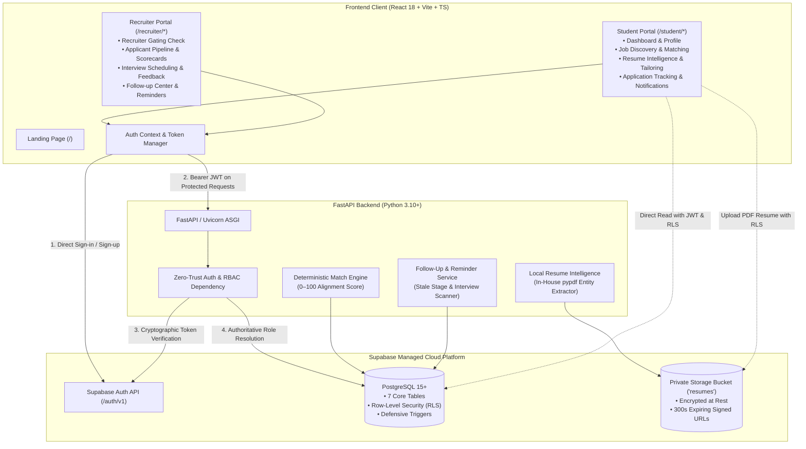
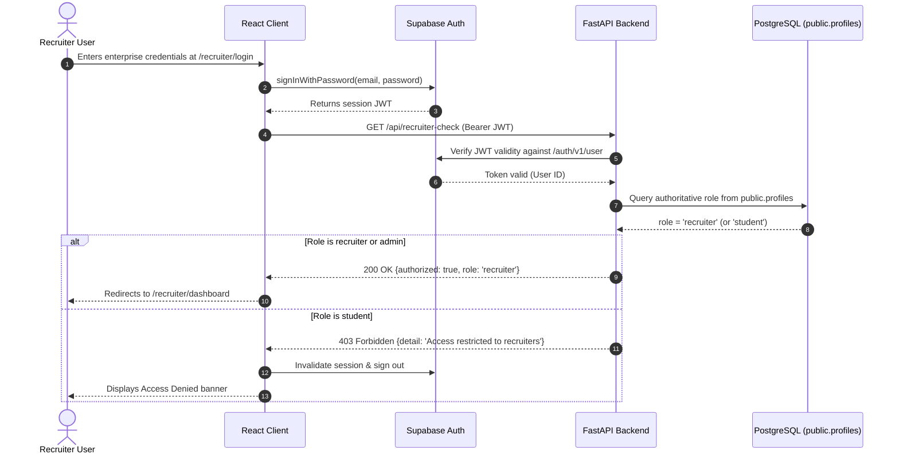

# HireFlow — System Architecture & Security Specification

This document provides a comprehensive technical overview of the architecture, security guarantees, data models, and service boundaries of **HireFlow**, an Applicant Tracking System (ATS) connecting student talent with corporate hiring teams.

---

## 1. System Architecture Overview

---

## 2. Authentication & Role-Based Access Control (RBAC)

HireFlow enforces a **defense-in-depth** security model across client, API, and database layers:

### Security Guarantees:
1. **Unconditional Student Default**: Public self-registration (`/student/signup`) triggers `handle_new_auth_user()` in PostgreSQL, which strictly hardcodes `role = 'student'`. Any client-supplied metadata attempting privilege escalation is ignored.
2. **Role Tampering Prevention**: The `prevent_profile_role_tampering()` trigger blocks any `UPDATE` operation on `public.profiles.role` by authenticated users. Roles can only be changed by database administrators or backend `service_role`.
3. **Recruiter Ownership Gating**: All recruiter actions (viewing applicants, advancing pipeline stages, scheduling interviews, downloading candidate resumes) strictly verify that `job.recruiter_id == authenticated_user_id`.
4. **Private Resume Vault**: Candidate resumes are saved to a non-public Supabase Storage bucket (`resumes/{student_id}/resume.pdf`). The backend generates expiring signed URLs (300 seconds) only after verifying that the requesting recruiter owns an active job to which the student has applied.

---

## 3. Database Schema & RLS Matrix

### Core Tables

| Table | Primary Key | Description | Critical Constraints |
| :--- | :--- | :--- | :--- |
| `profiles` | `id` (FK `auth.users`) | User accounts & authoritative roles | `role IN ('student', 'recruiter', 'admin')` |
| `candidate_profiles` | `id` (UUID) | Candidate career details, skills & resume path | Unique `student_id` |
| `jobs` | `id` (UUID) | Job listings | `recruiter_id` FK, enum constraints for work mode & type |
| `applications` | `id` (UUID) | Job applications & pipeline stages | **`UNIQUE (job_id, student_id)`** (one app per job) |
| `interviews` | `id` (UUID) | Scheduled interview rounds & feedback | FK `application_id`, format & status enums |
| `activity_logs` | `id` (UUID) | Immutable audit log of application events | Append-only (INSERT permitted, no UPDATE/DELETE) |
| `notifications` | `id` (UUID) | Candidate and recruiter notifications | FK `recipient_id`, read state tracking |

### Row-Level Security (RLS) Policy Summary

| Table | Student Permissions | Recruiter Permissions | Admin |
| :--- | :--- | :--- | :--- |
| `profiles` | SELECT own, UPDATE own (`full_name`) | SELECT applicants to own jobs | ALL |
| `candidate_profiles` | SELECT own, INSERT own, UPDATE own | SELECT applicants to own jobs | ALL |
| `jobs` | SELECT where `status = 'published'` | SELECT/INSERT/UPDATE/DELETE own jobs | ALL |
| `applications` | SELECT own, INSERT own (if job published) | SELECT applicants to own jobs, UPDATE stage | ALL |
| `interviews` | SELECT interviews for own applications | SELECT/INSERT/UPDATE for own job applications | ALL |
| `activity_logs` | SELECT own activity logs | SELECT/INSERT on own job applications | ALL |
| `notifications` | SELECT own, UPDATE own (mark read) | SELECT own, UPDATE own (mark read) | ALL |

---

## 4. Key Subsystem Architectures

### A. Deterministic Match Engine (`matching_service.py`)
Calculates an objective 0–100 alignment score between a candidate profile and a published job without third-party hallucinations:
- **Required Skills Overlap (50 pts max)**: Evaluates normalized technical skills using semantic alias maps (`React.js` &rarr; `React`, `TS` &rarr; `TypeScript`, `K8s` &rarr; `Kubernetes`, etc.).
- **Role & Specialization Alignment (20 pts max)**: Keyword alignment across target roles, headlines, and work experience.
- **Location & Work Mode (15 pts max)**: Matching remote flexibility, hybrid locations, and candidate preferences.
- **Experience Level (15 pts max)**: Candidate seniority match against required job experience levels.
- **Human-in-the-Loop Governance**: Accompanied by positive and negative factor lists, clearly designated as decision support.

### B. In-House Resume Intelligence (`resume_intelligence_service.py`)
- **Local PDF Parsing**: Pure-Python `pypdf` extraction executing entirely in backend memory with zero external API calls.
- **Entity Extraction**: Regex and keyword matching for skills, degree levels, graduation years, work experiences, and certifications.
- **Scanned Document Detection**: Multi-page PDFs yielding < 40 total characters of text are flagged as `is_scanned_or_empty: True` with explicit guidance for searchable PDF export.
- **Job-Specific Tailoring**: Compares resume text against active job postings, isolating matched skills, missing keywords, and actionable tailoring tips.

### C. Follow-up Intelligence & Reminders (`follow_up_service.py`)
- **Stale Stage Detection**: Identifies applications pending beyond recommended SLAs (`applied` > 3 days, `screening` > 5 days, `interview` > 5 days, `offer` > 7 days).
- **Upcoming Interview Scanner**: Surfaces interviews scheduled within 24–48 hours and flags < 24h as high priority.
- **Idempotent Notification Dispatch**: Generates in-app notifications for upcoming rounds while preventing duplicate alerts across repeated scans.
