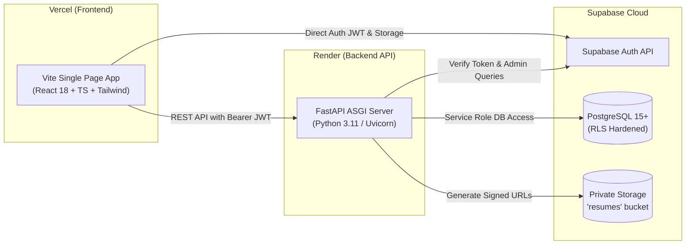

# HireFlow — Production Deployment Guide

This guide details the step-by-step procedure for deploying HireFlow to production across **Vercel** (Frontend), **Render** (Backend API), and **Supabase** (Database, Auth, and Storage).

---

## Architecture Deployment Map



---

## Production Endpoints Reference

| Service | Environment | Provider | URL |
| :--- | :--- | :--- | :--- |
| **Frontend Application** | Production | Vercel | [https://hire-flow-beryl-one.vercel.app](https://hire-flow-beryl-one.vercel.app/) |
| **Backend API** | Production | Render | [https://hireflow-giet.onrender.com](https://hireflow-giet.onrender.com/) |
| **API Health Check** | Production | Render | [https://hireflow-giet.onrender.com/health](https://hireflow-giet.onrender.com/health) |
| **Swagger OpenAPI Docs** | Production | Render | [https://hireflow-giet.onrender.com/docs](https://hireflow-giet.onrender.com/docs) |

---

## 1. Database & Storage Setup (Supabase)

1. **Create Supabase Project**:
   Create a new project in your [Supabase Dashboard](https://supabase.com).
2. **Execute Migrations in Sequential Order**:
   In the **SQL Editor**, run the following scripts located in `database/migrations/`:
   - `001_initial_schema.sql`: Core tables (`profiles`, `candidate_profiles`, `jobs`, `applications`, `interviews`, `activity_logs`, `notifications`) and triggers forcing default `student` role.
   - `002_row_level_security.sql`: Enables RLS across all tables and establishes strict access policies.
   - `003_storage.sql`: Creates private `resumes` bucket with 5MB file limits and PDF MIME restrictions.
   - `004_student_portal_enhancements.sql`: Audit triggers for application submission and stage change notifications.
   - `005_recruiter_portal_enhancements.sql`: Compensation and currency schema updates.
3. **Optional Seed Data**:
   Execute `database/seed_jobs.sql` to populate sample corporate job listings.
4. **Recruiter Provisioning**:
   Recruiters cannot sign up directly. Have the recruiter user register via `/student/signup`, then run `database/provision_recruiter.sql` with their email address in the SQL Editor to grant the `recruiter` role.
5. **Authentication URL Configuration**:
   In **Authentication &rarr; URL Configuration**:
   - **Site URL**: `https://hire-flow-beryl-one.vercel.app`
   - **Redirect URLs**:
     - `https://hire-flow-beryl-one.vercel.app/**`
     - `https://hire-flow-beryl-one.vercel.app/student/dashboard`
     - `https://hire-flow-beryl-one.vercel.app/recruiter/dashboard`

---

## 2. Backend Deployment (Render)

The backend is configured as a Render Web Service using `backend/render.yaml`.

### Render Service Configuration:
- **Environment**: Python
- **Root Directory**: `backend`
- **Build Command**: `pip install -r requirements.txt`
- **Start Command**: `uvicorn app.main:app --host 0.0.0.0 --port $PORT`

### Render Environment Variables:

| Variable | Recommended Value / Format | Exposure | Purpose |
| :--- | :--- | :--- | :--- |
| `PYTHON_VERSION` | `3.11.9` | Internal | Specifies Python runtime version |
| `ENVIRONMENT` | `production` | Internal | Sets production configuration mode |
| `PORT` | Set automatically by Render (e.g., `10000`) | Internal | Service port binding |
| `SUPABASE_URL` | `https://<your-project-id>.supabase.co` | Secret | Supabase project API base URL |
| `SUPABASE_PUBLISHABLE_KEY` | `sbp_...` or anon JWT | Public safe | Anon key for Supabase Auth calls |
| `SUPABASE_SERVICE_ROLE_KEY` | `eyJhbGciOi...` | **Strictly Secret** | Service-role key for administrative backend queries |
| `CORS_ORIGINS` | `https://hire-flow-beryl-one.vercel.app,http://localhost:5173` | Internal | Comma-separated list of allowed frontend origins |

> [!CAUTION]
> Never expose `SUPABASE_SERVICE_ROLE_KEY` to any client-side bundle or public repository.

### Verification:
After deployment completes, check:
```bash
curl https://hireflow-giet.onrender.com/health
# Expected output: {"status":"ok","service":"hireflow-backend","version":"1.0.0","database_configured":true}
```

---

## 3. Frontend Deployment (Vercel)

The frontend is deployed to Vercel as a Vite Single Page Application.

### Vercel Project Configuration:
- **Framework Preset**: Vite
- **Root Directory**: `frontend`
- **Build Command**: `npm run build` (runs `tsc && vite build`)
- **Output Directory**: `dist`
- **Install Command**: `npm install`
- **SPA Rewrites**: Defined in `frontend/vercel.json`:
  ```json
  {
    "framework": "vite",
    "rewrites": [
      {
        "source": "/(.*)",
        "destination": "/index.html"
      }
    ]
  }
  ```

### Vercel Environment Variables:

| Variable | Example Value | Exposure | Purpose |
| :--- | :--- | :--- | :--- |
| `VITE_API_BASE_URL` | `https://hireflow-giet.onrender.com` | Public | Base URL for FastAPI backend endpoints |
| `VITE_SUPABASE_URL` | `https://<your-project-id>.supabase.co` | Public | Supabase project URL |
| `VITE_SUPABASE_PUBLISHABLE_KEY` | `sbp_...` or anon JWT | Public | Supabase publishable/anon key |

> [!NOTE]
> All variables prefixed with `VITE_` are embedded in the client-side JavaScript bundle during build time. Never include service-role keys or database passwords in Vercel settings.

---

## 4. Post-Deployment Verification Checklist

1. [ ] Check `GET https://hireflow-giet.onrender.com/health` returns `database_configured: true`.
2. [ ] Open `https://hire-flow-beryl-one.vercel.app` and confirm the landing page displays the green operational status badge.
3. [ ] Test student registration at `/student/signup` and verify redirection to `/student/dashboard`.
4. [ ] Verify job browsing at `/student/jobs` displays published opportunities and deterministic match scores.
5. [ ] Attempt to sign in to `/recruiter/login` with student credentials and confirm immediate `403 Forbidden` rejection.
